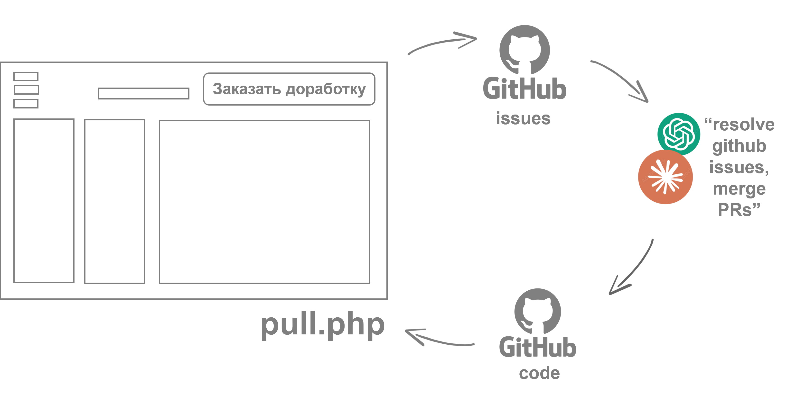

**Написать разработчику**  
[Telegram: no_illusions](http://t.me/no_illusions) · [Моё портфолио](https://dansury.github.io)  
Буду рада пообщаться!

# NeuroSaaS — основа вашего AI-сервиса

Основано на [шаблоне NeuroSaaS](https://github.com/dansury/neurosaas_template/).
При переименовании и доработке проекта сохраняйте эту ссылку на оригинал.

Это готовая инфраструктура сайта, который может дорабатываться прямо из собственной админ-панели: загрузите на хостинг один `pull.php` для установки из своего репозитория или весь распакованный архив для запуска без GitHub. После установки нажмите «Открыть сайт», затем «Админка». Подтвердите email кодом из письма — и сможете подключить нейросети, настроить обновления и начать разработку.

## Как работает цикл доработки

Нажмите «Заказать доработку» в сервисе, опишите задачу отравьте (уйдет в issues вашего репохитория). напишите ChatGPT Codex: "resolve github issues in github.com/...адрес_вашего_репозитория... , merge PRs” (для Claude надо выбрать репозиторий в меню под полем ввода).

После исправления и слияния PR код попадает в GitHub, а `pull.php` устанавливает обновление сервиса.

## Первый запуск

Есть два равноценных способа открыть **одну и ту же админку**:

- **Один файл:** загрузите `pull.php`; он скачает остальные файлы из вашего GitHub-репозитория. Порядок описан ниже.
- **Полный архив, без GitHub:** скачайте ZIP, распакуйте его на компьютере и загрузите **содержимое папки проекта**, включая `admin/` и скрытые `.htaccess`, в папку сайта. Откройте `/admin/?install=local` либо `/pull.php` → «Файлы уже загружены — настроить без GitHub». Задайте пароль установки, войдите, укажите email и новый пароль, подтвердите код из письма и войдите снова. Репозиторий и ключ GitHub для этого не нужны.

Для AI нужны API-ключ и доступ к провайдеру, для кода подтверждения — SMTP или рабочая функция `mail()` на хостинге, для отправки идей в GitHub — подключённый репозиторий и ключ Issues: Read and write. Даже при локальной установке подтверждение email обязательно.

На хостинге нужны PHP 8.1+, расширения `curl`, `pdo_sqlite`, `zip`, `dom`, `mbstring`, `openssl`, запись в папку сайта и защищённые папки данных, а также рабочие PHP-сессии. Используйте HTTPS. На Nginx закройте прямой HTTP-доступ к `admin/account/`, `admin/deployment/` и `admin/llm_connector/`; Apache/LiteSpeed использует вложенные `.htaccess`.

### Что вы получите "из коробки"

Главная страница — **Hello, world!** со ссылкой «Админка». Внутри — настройка установки, вход и восстановление пароля, подтверждение email, обновления/история/откат при подключённом GitHub, AI-провайдеры, SMTP, документы/OCR, локальный журнал и «Заказать доработку». Чат, CRM или другой пользовательский продукт ещё не созданы: это готовая инфраструктура для их разработки.

Откройте [обзор реальных экранов](specs/interface-tour.md). Компьютер, AI-агент, Composer, Node.js и сборка для установки не нужны; архив можно загрузить файловым менеджером хостинга.

### Установка через один pull.php

1. Нажмите [Use this template](https://github.com/dansury/neurosaas_template/generate) и создайте свой репозиторий.
2. Загрузите только `pull.php` в папку сайта на PHP-хостинге и откройте его адрес (или pull.py + pull.sh - в папку на компьютере). Откойте yoursite.ru/pull.php (или запустите pull.sh на компьетере).
3. Укажите свой репозиторий в виде `owner/name`, ветку `main` и ключ GitHub. Выберите доступ только к своему репозиторию: Contents — Read, Issues — Read and write; Pull requests — Read.
4. Задайте пароль установки, сохраните настройки и установите актуальную версию.
5. Нажмите «Открыть сайт», затем ссылку «Админка» справа сверху.
6. Войдите с паролем установки, задайте email и новый пароль от 12 символов. Введите шестизначный код из письма, затем войдите с новым паролем.

Если письмо не пришло, проверьте спам и отправку почты на хостинге. Для первой регистрации используется почта хостинга или SMTP из окружения PHP. Попросите хостинг настроить SMTP_HOST, SMTP_PORT, SMTP_USER, SMTP_PASS, SMTP_FROM. После входа почта редактируется в админке. Код действует 10 минут; повторный запрос возможен через минуту. «Забыли пароль?» отправит код только на подтверждённый адрес.

## Ежедневная работа

В `admin/` собраны кнопка «Обновить», автообновление, история и откат версий, настройки моделей и почты, диагностика и запросы на доработку. На главной странице сайта остаётся ваш рабочий интерфейс.

Передайте AI-агенту ссылку на свой репозиторий и опишите, для кого нужен сервис, что он должен делать и как проверить результат. Агент сначала читает CLAUDE.MD, затем specs/index.md и спецификацию нужного модуля. Готовые изменения приходят на сайт после обновления из админки.

## Где что находится

| Путь | Для чего |
| --- | --- |
| index.php | Главная страница: Hello, world! и ссылка на админку |
| pull.php | Отдельный установщик для загрузки на хостинг |
| pull.py + pull.sh | Отдельный установщик для загрузки в папку на компьютере |
| admin/index.php | Вход и все настройки сервиса |
| admin/account/ | Подтверждение email, пароль и восстановление |
| admin/deployment/ | Установка, автообновление, история и откат |
| admin/llm_connector/ | Нейросети, документы, OCR, почта и диагностика |
| specs/ | Все спецификации и технические документы |
| tests/ | Автопроверки кода |

## Подключение к своему интерфейсу

Для страницы сервиса подключите перед выводом `admin/llm_connector/bootstrap.php`. Настройки открываются по адресу `admin/?toolkit=1`, доработки — `admin/?feedback=1`. Изначально отчёты об ошибках остаются локальными; отправка включается владельцем отдельно.

Поддерживаются Yandex Cloud, GenRouter и OpenRouter. Для YandexGPT используется Foundation Models; для OpenAI-совместимых моделей Yandex — отдельный маршрут с адресом https://ai.api.cloud.yandex.net/v1. Сохранение ключа не запускает платную проверку: для неё есть отдельная кнопка.

Начальный интерфейс — нейтральная белая страница без чужого продукта и его бизнес-логики. Меняйте `index.php` под свою задачу; установку, аккаунт и инфраструктурные модули развивайте по их контрактам. Для установки на хостинг не нужны Composer, Node.js, сборка фронтенда или утилиты из папки обслуживания.

## Зачем нужны Markdown-файлы

Это документация для разработчика и AI-агента. Сами файлы не исполняются и ничего не подключают автоматически.

- `CLAUDE.MD` и `AGENTS.MD` задают правила работы: что сохранять, как вносить изменения и проверять результат.
- `specs/index.md` ведёт к контрактам модулей: что они делают, какие у них ограничения и как должны работать ошибки, настройки и защита данных.
- `README.md` внутри модуля объясняет его назначение, первый запуск и подключение. В том числе это подсказки агенту по интеграции библиотек, но не замена работающему коду.
- `.specify/memory/constitution.md` хранит общие принципы разработки; `spec.md`, `plan.md` и `tasks.md` описывают конкретную задачу и её проверку.
- `tests/` проверяет эти контракты на локальных данных.

Для будущей доработки дайте агенту сначала прочитать `CLAUDE.MD`, затем `specs/index.md` и только спецификацию нужного модуля. При изменении поведения обновляйте код, документацию и соответствующие проверки вместе. Публичные API и неочевидные решения должны иметь краткие комментарии; дублировать каждую строку кода в документации не нужно.

## Хостинг и сохранность данных

PHP 8.1+; расширения curl, pdo_sqlite, zip, dom, mbstring, openssl; исходящий HTTPS и работающие сессии. Для писем нужна почта хостинга или SMTP. Только установщик совместим с PHP 7.4+. Для Nginx запретите прямой HTTP-доступ к admin/account/, admin/deployment/ и admin/llm_connector/: открытым должен быть admin/index.php. В Apache/LiteSpeed правила уже приложены.

Не добавляйте секреты в Git. Пароли хранятся как хеши, ключи — на сервере. Обновление сохраняет конфигурацию, историю, данные модулей и состояние учётной записи. При переходе со старой структуры локальные данные переносятся до первого обращения к модулю; существующие настройки назначения не перезаписываются.

Для cron используйте `pull.php?check=1&plain=1` с паролем в заголовке X-Pull-Password. Пароль в URL не передавайте. Для обновлений без cron включите проверки при посещении страниц или в открытой админке. Откат приостанавливает автоматическую установку.

Технические подробности: [спецификации](specs/index.md). Проверки: `bash tests/run_all.sh`.

## Обновление архивом и с компьютера

В админке можно загрузить ZIP: корневой `index.php`/`index.html` или один внешний
каталог, как в архиве GitHub. Настройки, `.env`, `data`, `storage` и история
сохраняются. Перед первым обновлением архивом создаётся копия установленного кода.
Версия возвращается из «Предыдущих версий»; автообновление после отката
приостановлено. Чтобы продолжить разработку от выбранной версии, восстановите её
файлы новым коммитом и PR в `main`, сохранив последующую историю.

Для компьютера скачайте **pull.py** в папку проекта и запустите `python pull.py`.
Для Windows рядом есть `pull.cmd`, для Linux/macOS — `pull.sh`: если Python нет,
они покажут [официальную страницу загрузки](https://www.python.org/downloads/).
Нужен Python 3.9+. Скрипт предлагает ссылку создания ключа, выбирает репозиторий
и ветку (main по умолчанию), устанавливает зависимости и проверяет обновления раз
в минуту, пока терминал открыт. `--once` делает одну проверку; `--no-deps`
пропускает установку зависимостей; `--rollback <полный-SHA>` возвращает скачанную
версию и останавливает проверки. На Windows храните папку в своём профиле:
права `chmod` там не заменяют ограничения NTFS.

Новая установка не просит отдельного пароля установки. До создания подтверждённой
учётной записи настройка привязана к сессии начавшего её браузера. Если она
потеряна до подтверждения email, удалите `pull-config.php` через панель хостинга и
начните установку заново. Существующие пароли и учётные записи сохраняются.

GenRouter выбран первым. После добавления ключа обновите каталог: текстовая,
vision- и голосовая модели выбираются только из возможностей, сообщённых API.
Каталог без ключа отвечает Missing API key; конкретные живые модели и платные
вызовы в проверках разработки не использовались. Дополнительные провайдеры
подключаются отдельно. Для скриншотов обратной связи ключу GitHub нужны
`Contents: Read and write`; для задач — `Issues: Read and write`.

PHP 8.5 не требуется: проверки выполняются на 8.1 и 8.3. Минимальный установщик
предназначен для PHP 7.4+, при более старом обработчике показывает требования до
разбора основного кода. Версию Apache сообщает только сам сервер; для `.htaccess`
используйте Apache 2.4+ либо аналогичные правила nginx. Сам PHP должен быть
включён на хостинге. SMTP необязателен для сервиса без исходящих писем;
подтверждение email администратора требует работающей почты хостинга или SMTP.

## Приложение и уведомления

Откройте «Установить приложение» на стартовой странице, чтобы добавить сервис
на телефон или компьютер. В админке раздел «Приложение и уведомления» позволяет
включить уведомления на текущем устройстве, проверить их и отключить.
Разрешение браузера запрашивается только по кнопке. Нужен HTTPS; на iPhone
сначала добавьте приложение на экран «Домой» через Safari.

Личные страницы и настройки не кешируются для автономного просмотра.
События приложения подключает разработчик через отдельный
[модуль WebApp](admin/webapp/README.md); для него не нужны Composer или сборка.

