# Как выглядит шаблон сразу после загрузки

Экраны сняты 21 октября 2026 года с запущенного PHP-приложения. Это реальный интерфейс шаблона, без разработки отдельного продукта. Для прохождения регистрации использовалась тестовая доставка email; платные AI-запросы, реальные письма и создание задач из формы не выполнялись. В примере подключённого GitHub показан тестовый owner/repo с подменённым транспортом. Скриншоты сняты на PHP 8.5; поддерживаемые PHP 8.1/8.3 проверяются в CI.

Откройте [полную галерею](interface-tour.html) после скачивания репозитория: HTML и папка interface-screens должны оставаться рядом. Ниже доступны основные экраны непосредственно в Markdown.

## Главная

По адресу сайта открывается Hello, world!, объяснение первого запуска и ссылка «Админка». Пользовательского чата, CRM, личного кабинета клиента и другого прикладного продукта пока нет.

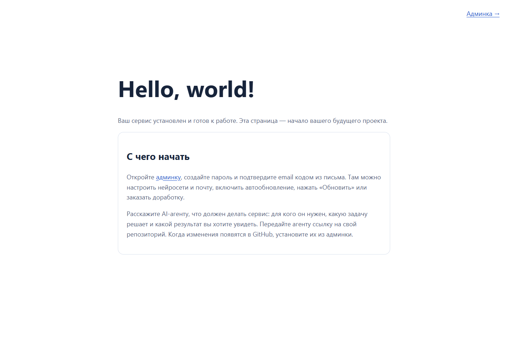

## pull.php и локальная установка

Один файл pull.php спрашивает репозиторий, ключ GitHub и пароль. Полный архив предлагает также режим «Файлы уже загружены». Оба пути используют одинаковый движок админки.

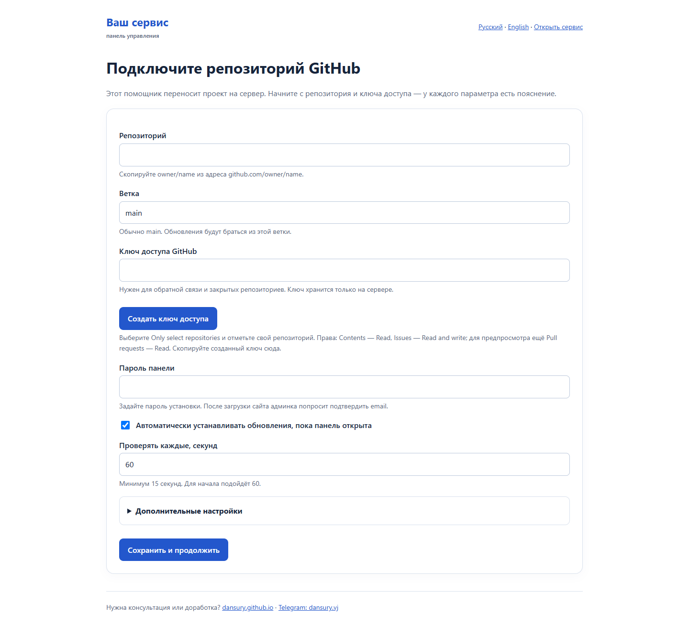

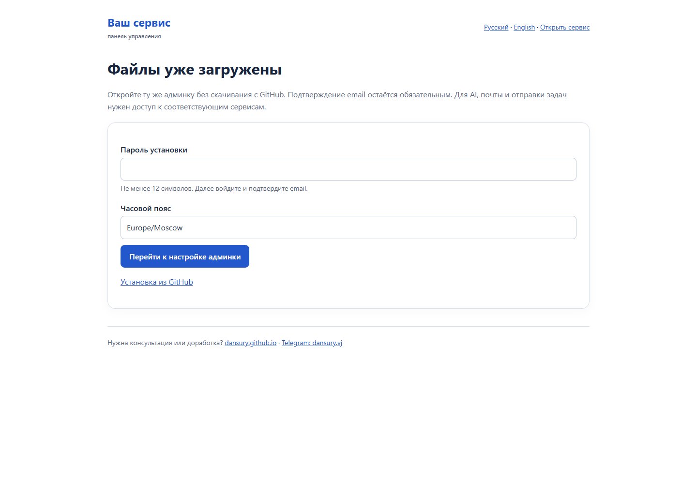

## Доступ администратора

После установки: пароль установки → email и новый пароль → повторный вход. Для первого администратора письмо и код не нужны. Почта потребуется позже только для восстановления пароля на сохранённый email.

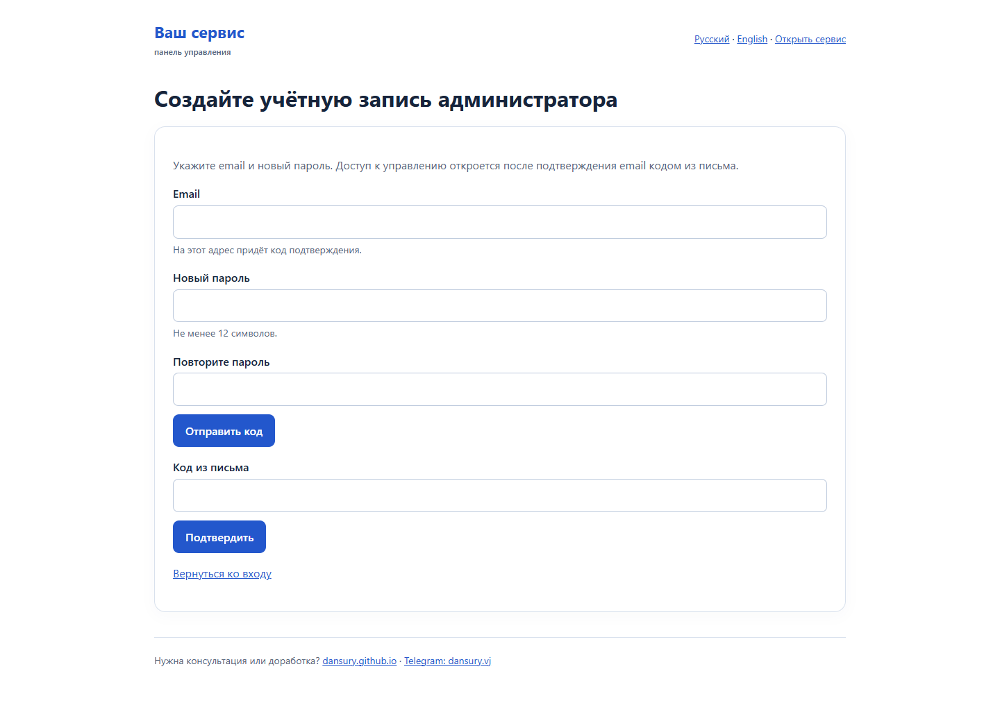

## Админка

Локальный режим показывает, что автоматических GitHub-проверок нет. Подключить репозиторий можно позже. Остальные настройки доступны сразу после создания администратора.

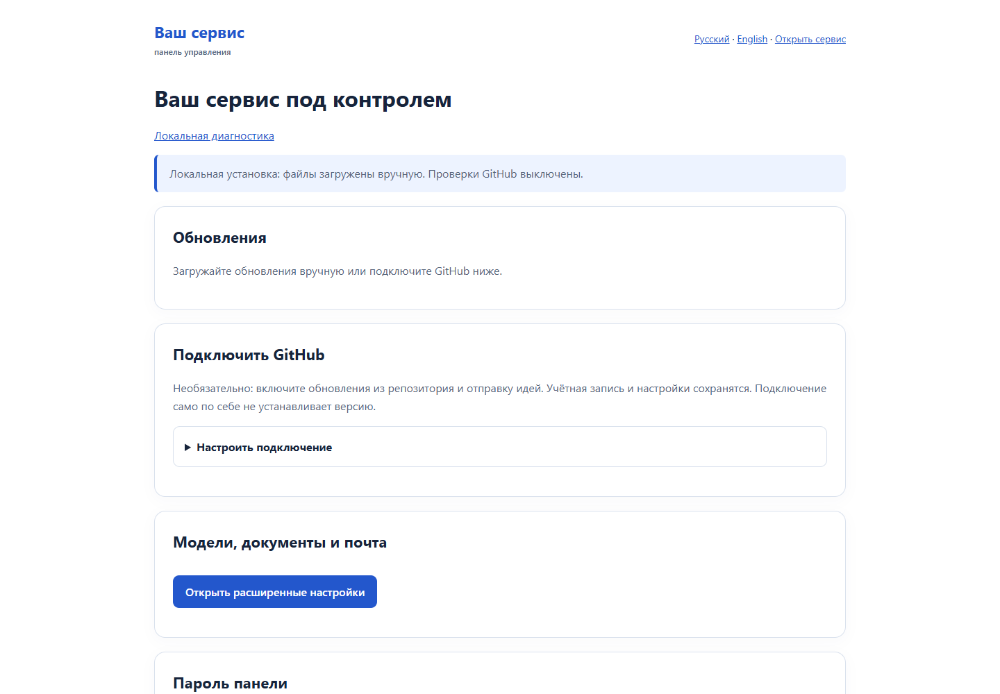

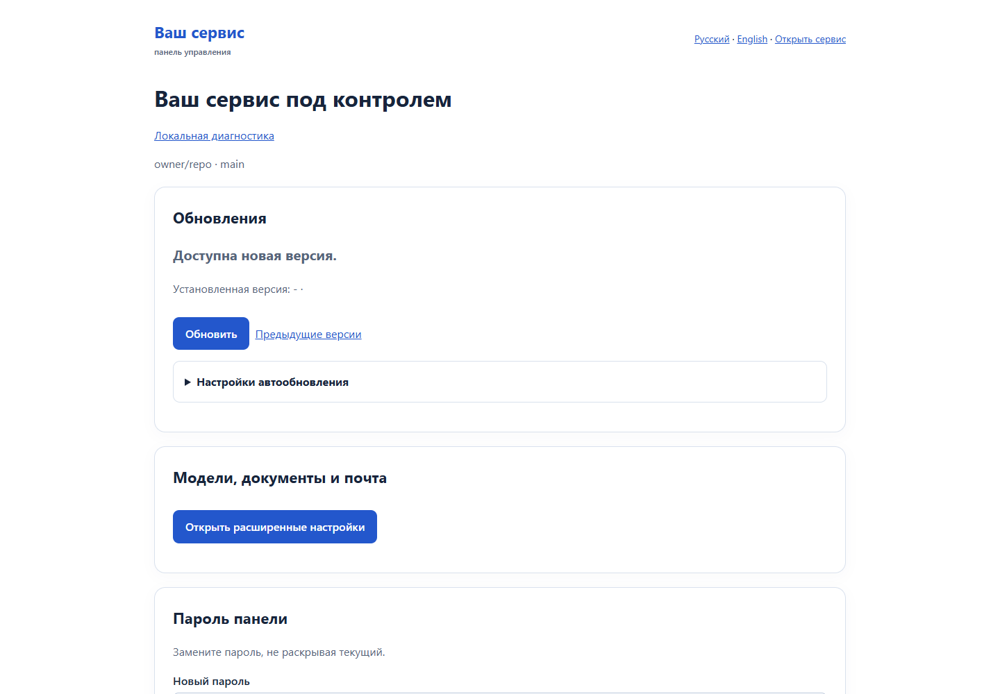

## Нейросети, почта и инфраструктура

Есть GenRouter, Yandex и OpenRouter, порядок резервирования и отдельные кнопки проверки. Сохранение ключа не доказывает, что подключение работает. Расширенные настройки содержат модели, документы/OCR, SMTP, обновление модуля и его локальный журнал. Автоматические отчёты разработчику включаются только отдельно по согласию.

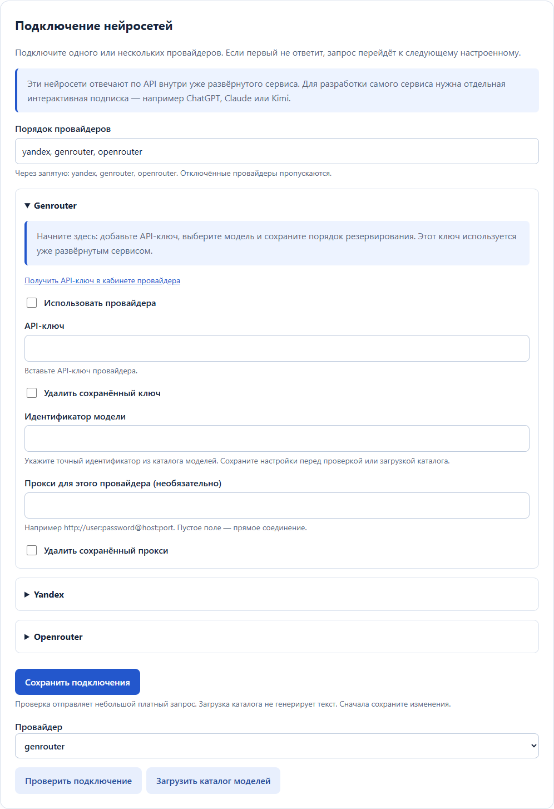

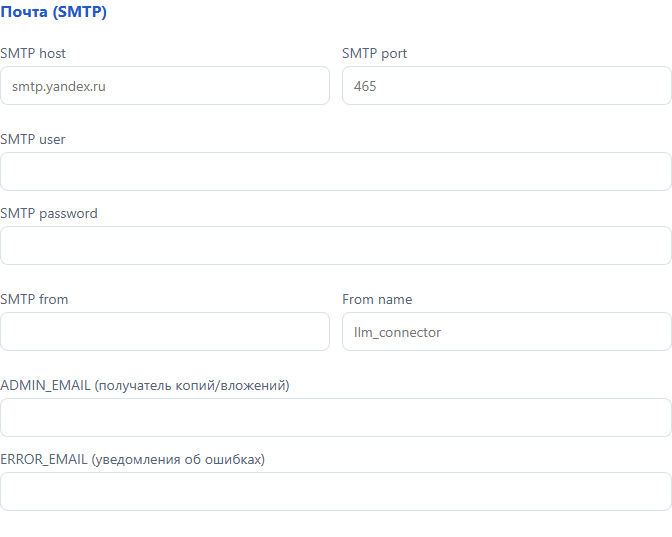

## Идеи и ошибки

Форма «Заказать доработку» принимает описание и необязательное название. Журнал прикладывается только после выбора флажка; пользователь видит снимок до отправки. В GitHub он становится текстовым блоком внутри задачи. Без подключённого репозитория и Issues-write ключа отправка не происходит.

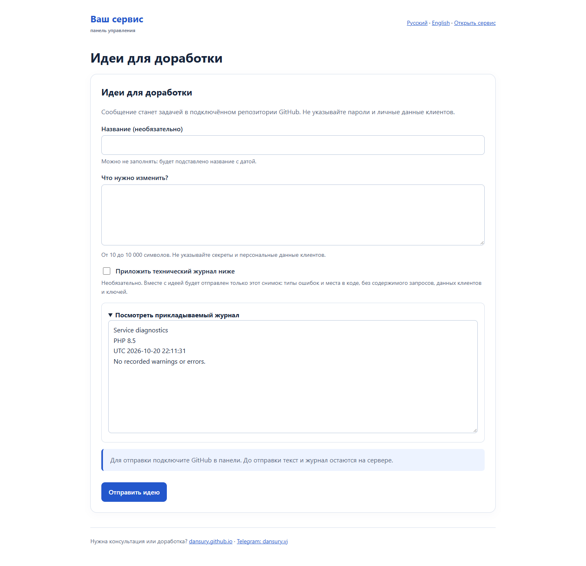

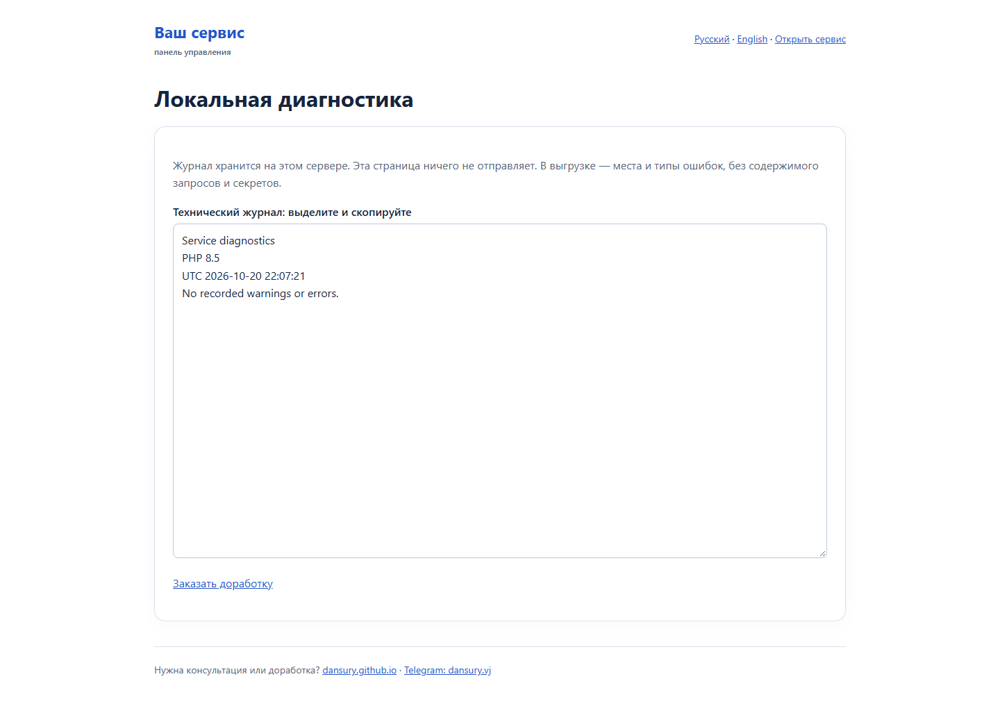

## Телефон

Проверены локальная админка и форма на ширине 390 px: горизонтального переполнения нет.

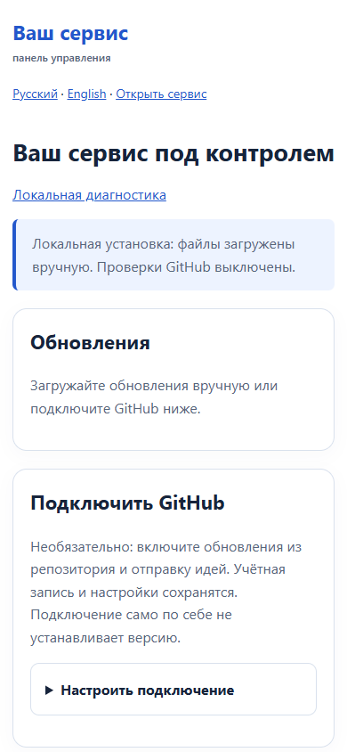

Дополнительные экраны — вход, готовность установки, полная длинная админка и модуль, история, восстановление пароля, мобильная форма — находятся в [галерее](interface-tour.html).
